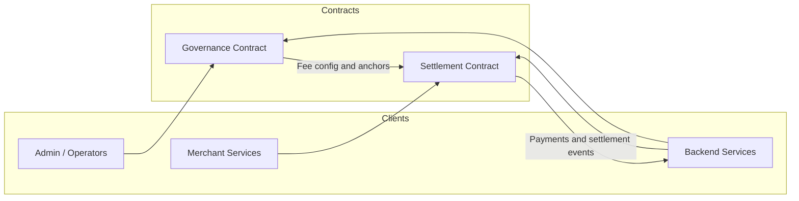

# BettaPay Contracts

Soroban smart contracts for the BettaPay payment infrastructure on Stellar.

## Payment reference read access

`get_payment_reference` and `get_payments` are intentionally public so
off-chain settlement indexers and composing contracts can verify a payment
without a merchant signature. A payment reference is a 32-byte value supplied
by the merchant and must be generated with cryptographically secure randomness;
it functions as a bearer capability for lookup. Indexers may consume
`payment_stored` events for discovery and use these endpoints for targeted
verification; raw Soroban state reads remain an equivalent alternative.

## Structure

```
BettaPay-Contract/
├── Cargo.toml                  # Rust workspace root (both contracts)
├── settlement_contract/        # Merchant registration, fee splits, payment references
│   ├── Cargo.toml
│   └── src/lib.rs
├── governance_contract/        # Fee config, anchor registry, system params
│   ├── Cargo.toml
│   └── src/lib.rs
├── bettapay_common/            # Shared constants, types, error codes, and storage keys
├── docs/                       # Core protocol architecture and lifecycle specifications
│   ├── scheduled-operation-lifecycle.md # Timelocked queue, collision rules, and 9 operations
│   ├── recovery-lifecycle.md   # Emergency recovery flow, delays, and failure modes
│   ├── bootstrap-fallback.md   # 4-tier settlement rule fallback chain and emission rules
│   ├── storage-key-ownership.md # Storage key matrix, ownership, and TTL policies
│   ├── contract-limits.md      # Protocol constants and bounds reference
│   └── archive-and-tombstones.md # Merchant archiving and tombstone semantics
├── scripts/
│   ├── deploy_testnet.sh       # Build + deploy both contracts + init admin
│   ├── simulate.sh             # Simulate contract calls locally
│   ├── export_events.sh        # Dump contract events over a ledger range
│   ├── list_pending_ops.sh     # Show pending timelocked operations
│   ├── verify_wasm_hash.sh     # Compare deployed Wasm hash to local build
│   └── check_interface_parity.sh # Fail when the two contracts' interface versions drift
└── DEVELOPMENT.md              # Upgrade and storage-migration guide
```

## Core Documentation

- **[Scheduled Operation Lifecycle](docs/scheduled-operation-lifecycle.md)**: State machine, allowed transitions, duplicate vs. genuine hash collision (codes `12` and `316`), minimum 7-day timelock delay, emergency recovery veto, permissionless execution, and reference for all nine `Operation` variants.
- **[Admin Recovery Lifecycle](docs/recovery-lifecycle.md)**: End-to-end recovery sequence, actors, 7-day `RECOVERY_DELAY_SECONDS`, cancellation rules, failure modes (`RecoveryNotPending` `8`, `RecoveryDelayActive` `9`, `RecoveryAlreadyPending` `15`), and scheduled operation veto semantics.
- **[Bootstrap Fallback Semantics](docs/bootstrap-fallback.md)**: The 4-tier resolution chain (merchant → default → governance → bootstrap), trigger conditions, field values (`100` platform bps, `5` network bps, `0` delay, `auto_settle` false), and event emission rules.
- **[Storage Key Ownership and TTL Policies](docs/storage-key-ownership.md)**: Authoritative mapping of all settlement, governance, and `CommonDataKey` keys to owning crates, storage kinds, and TTL bump policies.
- **[Contract Limits](docs/contract-limits.md)**: Numeric bounds, fee limits, batch limits, and their enforcement points.
- **[Event Topic Convention](docs/event-topics.md)**: The canonical topic registry, emitted topic set, and indexer-facing naming rules.

## Deployed Addresses (Testnet)

| Contract     | Address                                                  |
|-------------|----------------------------------------------------------|
| Settlement  | `CBGBGKJSUY7XYB6HWW4CVAU6MW2KD25FSF45E5KCP53TKUK374MBZNFB` |
| Governance  | `CDPFWUTIXF5BC6BKNDLSQOZSDQCXAJNZFCZWHBE2RRHANRN25T3ILPZ7` |
| Admin       | `GCCHHKNI7GRA5QWC7RCTT3OHO7SKAUMKQA6IBWEQEO2SXI3GF376UHDD` |

Network: `Test SDF Network ; September 2015`

## Toolchain Requirements

- **Rust (MSRV): 1.85.0.** The minimum supported Rust version is the channel
  pinned in `rust-toolchain.toml`. CI builds and tests the workspace on it in a
  separate MSRV job; reproduce it locally with `make msrv`.
- **soroban-cli: 21.5.0.** Pinned once as `SOROBAN_VERSION` in the `Makefile`.
  Install it with `make install_soroban` and check it with `make check_soroban`.

See [CONTRIBUTING.md](CONTRIBUTING.md#toolchain-pins) for details.

## Quick Start

```bash
# Run all tests
cargo test

# Build WASM release binaries
cargo build --target wasm32-unknown-unknown --release

# Deploy to testnet (requires soroban CLI)
bash scripts/deploy_testnet.sh
```

## CLI Usage Examples

All examples below assume you have the [Soroban CLI](https://soroban.stellar.org/docs) installed and a funded testnet identity.

### Build

```bash
# Build all contracts (release WASM)
cargo build --target wasm32-unknown-unknown --release

# Build a specific contract
cargo build --target wasm32-unknown-unknown --release -p settlement_contract
cargo build --target wasm32-unknown-unknown --release -p governance_contract
```

### Test

```bash
# Run all tests
cargo test

# Run tests for a specific contract
cargo test -p settlement_contract
cargo test -p governance_contract

# Run a specific test by name
cargo test merchant_lifecycle_uses_canonical_topics -p settlement_contract
```

### Deploy to Testnet

```bash
# One-command deployment (builds + deploys + initializes both contracts)
bash scripts/deploy_testnet.sh

# Or deploy step-by-step:
# 1. Generate and fund a key
soroban keys generate bettapay-admin --fund

# 2. Build and optimize WASM
make optimize

# 3. Deploy settlement contract
SETTLEMENT_ID=$(soroban contract deploy \
  --wasm target/optimized/settlement_contract_opt.wasm \
  --source-account bettapay-admin \
  --rpc-url https://soroban-testnet.stellar.org \
  --network-passphrase "Test SDF Network ; September 2015")

# 4. Deploy governance contract
GOVERNANCE_ID=$(soroban contract deploy \
  --wasm target/optimized/governance_contract_opt.wasm \
  --source-account bettapay-admin \
  --rpc-url https://soroban-testnet.stellar.org \
  --network-passphrase "Test SDF Network ; September 2015")

# 5. Initialize both contracts
ADMIN=$(soroban keys address bettapay-admin)
RECOVERY_ADDRESS="$ADMIN"

soroban contract invoke \
  --id "$SETTLEMENT_ID" \
  --source-account bettapay-admin \
  --rpc-url https://soroban-testnet.stellar.org \
  --network-passphrase "Test SDF Network ; September 2015" \
  -- \
  init --admins "[\"$ADMIN\"]" --threshold 1 --governance "$GOVERNANCE_ID" --recovery-address "$RECOVERY_ADDRESS"

soroban contract invoke \
  --id "$GOVERNANCE_ID" \
  --source-account bettapay-admin \
  --rpc-url https://soroban-testnet.stellar.org \
  --network-passphrase "Test SDF Network ; September 2015" \
  -- \
  init --admins "[\"$ADMIN\"]" --threshold 1 --recovery-address "$RECOVERY_ADDRESS"
```

### Invoke Settlement Contract

```bash
# Set vars (adjust IDs as needed)
SETTLEMENT_ID=CBGBGKJSUY7XYB6HWW4CVAU6MW2KD25FSF45E5KCP53TKUK374MBZNFB
ADMIN=GCCHHKNI7GRA5QWC7RCTT3OHO7SKAUMKQA6IBWEQEO2SXI3GF376UHDD
MERCHANT=GXXXXXXXXXXXXXXXXXXXXXXXXXXXXXXXXXXXXXXXXXXXXXXXXXXXXXXX
RPC=https://soroban-testnet.stellar.org
PASS="Test SDF Network ; September 2015"

# Check admin
soroban contract invoke --id "$SETTLEMENT_ID" --source-account bettapay-admin \
  --rpc-url "$RPC" --network-passphrase "$PASS" -- \
  get_admin

# Register a merchant
soroban contract invoke --id "$SETTLEMENT_ID" --source-account bettapay-admin \
  --rpc-url "$RPC" --network-passphrase "$PASS" -- \
  register_merchant --merchant "$MERCHANT"

# Check if merchant is registered
soroban contract invoke --id "$SETTLEMENT_ID" --source-account bettapay-admin \
  --rpc-url "$RPC" --network-passphrase "$PASS" -- \
  is_merchant_registered --merchant "$MERCHANT"

# Set a settlement rule (250 bps platform, 50 bps network)
soroban contract invoke --id "$SETTLEMENT_ID" --source-account bettapay-admin \
  --rpc-url "$RPC" --network-passphrase "$PASS" -- \
  set_settlement_rule \
  --merchant "$MERCHANT" \
  --rule '{"platform_fee_bps": 250, "network_fee_bps": 50, "settlement_delay_ledger": 0, "auto_settle": false}'

# Calculate fee split without storing
soroban contract invoke --id "$SETTLEMENT_ID" --source-account bettapay-admin \
  --rpc-url "$RPC" --network-passphrase "$PASS" -- \
  calculate_fee_split --merchant "$MERCHANT" --amount 10000

# Store a payment reference (32-byte hex hash)
soroban contract invoke --id "$SETTLEMENT_ID" --source-account "$MERCHANT" \
  --rpc-url "$RPC" --network-passphrase "$PASS" -- \
  store_payment_reference \
  --merchant "$MERCHANT" \
  --reference "0xabcdef1234567890abcdef1234567890abcdef1234567890abcdef1234567890" \
  --amount 10000

# Fetch a stored payment
soroban contract invoke --id "$SETTLEMENT_ID" --source-account bettapay-admin \
  --rpc-url "$RPC" --network-passphrase "$PASS" -- \
  get_payment_reference \
  --reference "0xabcdef1234567890abcdef1234567890abcdef1234567890abcdef1234567890"

# Set a global default rule
soroban contract invoke --id "$SETTLEMENT_ID" --source-account bettapay-admin \
  --rpc-url "$RPC" --network-passphrase "$PASS" -- \
  set_default_rule \
  --new_rule '{"platform_fee_bps": 100, "network_fee_bps": 0, "settlement_delay_ledger": 0, "auto_settle": false}'

# Pause/unpause
soroban contract invoke --id "$SETTLEMENT_ID" --source-account bettapay-admin \
  --rpc-url "$RPC" --network-passphrase "$PASS" -- \
  pause

soroban contract invoke --id "$SETTLEMENT_ID" --source-account bettapay-admin \
  --rpc-url "$RPC" --network-passphrase "$PASS" -- \
  unpause
```

### Invoke Governance Contract

```bash
GOVERNANCE_ID=CDPFWUTIXF5BC6BKNDLSQOZSDQCXAJNZFCZWHBE2RRHANRN25T3ILPZ7
ASSET=GXXXXXXXXXXXXXXXXXXXXXXXXXXXXXXXXXXXXXXXXXXXXXXXXXXXXXXX
ANCHOR=GXXXXXXXXXXXXXXXXXXXXXXXXXXXXXXXXXXXXXXXXXXXXXXXXXXXXXXX

# Get admin
soroban contract invoke --id "$GOVERNANCE_ID" --source-account bettapay-admin \
  --rpc-url "$RPC" --network-passphrase "$PASS" -- \
  get_admin

# Set fee config (platform 120 bps, network 35 bps)
soroban contract invoke --id "$GOVERNANCE_ID" --source-account bettapay-admin \
  --rpc-url "$RPC" --network-passphrase "$PASS" -- \
  set_fee_config \
  --caller "$ADMIN" \
  --config '{"platform_fee_bps": 120, "network_fee_bps": 35}'

# Read fee config
soroban contract invoke --id "$GOVERNANCE_ID" --source-account bettapay-admin \
  --rpc-url "$RPC" --network-passphrase "$PASS" -- \
  get_fee_config

# Update a system parameter
soroban contract invoke --id "$GOVERNANCE_ID" --source-account bettapay-admin \
  --rpc-url "$RPC" --network-passphrase "$PASS" -- \
  update_system_param --caller "$ADMIN" --key '"max_settle"' --value 1440

# Read a system parameter
soroban contract invoke --id "$GOVERNANCE_ID" --source-account bettapay-admin \
  --rpc-url "$RPC" --network-passphrase "$PASS" -- \
  get_system_param --key '"max_settle"'

# Register an anchor for an asset
soroban contract invoke --id "$GOVERNANCE_ID" --source-account bettapay-admin \
  --rpc-url "$RPC" --network-passphrase "$PASS" -- \
  upsert_anchor --caller "$ADMIN" --asset "$ASSET" --anchor "$ANCHOR"

# Read an anchor
soroban contract invoke --id "$GOVERNANCE_ID" --source-account bettapay-admin \
  --rpc-url "$RPC" --network-passphrase "$PASS" -- \
  get_anchor --asset "$ASSET"

# Remove an anchor
soroban contract invoke --id "$GOVERNANCE_ID" --source-account bettapay-admin \
  --rpc-url "$RPC" --network-passphrase "$PASS" -- \
  remove_anchor --caller "$ADMIN" --asset "$ASSET"

# Transfer admin to a new address
soroban contract invoke --id "$GOVERNANCE_ID" --source-account bettapay-admin \
  --rpc-url "$RPC" --network-passphrase "$PASS" -- \
  transfer_admin --caller "$ADMIN" --new_admin "GYYYYYYYYYYYYYYYYYYYYYYYYYYYYYYYYYYYYYYYYYYYYYYYYYYYYYY"
```

### Local Simulation and Testing

For local development and testing without deploying to testnet, use the `simulate.sh` script:

```bash
# Run complete local simulation (builds, deploys, and initializes both contracts)
bash scripts/simulate.sh

# This outputs contract IDs and source identity:
# Source identity: bettapay-sim
# Source address: GYYYYYYYYYYYYYYYYYYYYYYYYYYYYYYYYYYYYYYYYYYYYYYYYYYYYYY
# Settlement contract ID: CYYYYYYYYYYYYYYYYYYYYYYYYYYYYYYYYYYYYYYYYYYYYYYYYYYYYYY
# Governance contract ID: CYYYYYYYYYYYYYYYYYYYYYYYYYYYYYYYYYYYYYYYYYYYYYYYYYYYYYY
```

After running `simulate.sh`, use the printed contract IDs for local testing:

```bash
# Example: Query settlement contract locally
SETTLEMENT_ID=CYYYYYYYYYYYYYYYYYYYYYYYYYYYYYYYYYYYYYYYYYYYYYYYYYYYYYY
GOVERNANCE_ID=CYYYYYYYYYYYYYYYYYYYYYYYYYYYYYYYYYYYYYYYYYYYYYYYYYYYYYY
SOURCE=bettapay-sim

# Get settlement contract admin
soroban contract invoke --id "$SETTLEMENT_ID" --source-account "$SOURCE" \
  --rpc-url https://soroban-testnet.stellar.org \
  --network-passphrase "Test SDF Network ; September 2015" -- \
  get_admin

# Register a test merchant
TEST_MERCHANT=GXXXXXXXXXXXXXXXXXXXXXXXXXXXXXXXXXXXXXXXXXXXXXXXXXXXXXXX

soroban contract invoke --id "$SETTLEMENT_ID" --source-account "$SOURCE" \
  --rpc-url https://soroban-testnet.stellar.org \
  --network-passphrase "Test SDF Network ; September 2015" -- \
  register_merchant --merchant "$TEST_MERCHANT"
```

### Environment Variable Setup

For repetitive testing, create a local `.env` file or set these variables:

```bash
# Testnet Configuration
export SOROBAN_RPC_URL="https://soroban-testnet.stellar.org"
export SOROBAN_NETWORK_PASSPHRASE="Test SDF Network ; September 2015"
export SOROBAN_ACCOUNT="bettapay-admin"

# Contract Addresses (update after deployment)
# After deployment, update the contract IDs in:
# - [BettaPay-Frontend](https://github.com/org/BettaPay-Frontend) `.env`
# - [BettaPay-Backend](https://github.com/org/BettaPay-Backend) `.env`
export SETTLEMENT_CONTRACT_ID="CBGBGKJSUY7XYB6HWW4CVAU6MW2KD25FSF45E5KCP53TKUK374MBZNFB"
export GOVERNANCE_CONTRACT_ID="CDPFWUTIXF5BC6BKNDLSQOZSDQCXAJNZFCZWHBE2RRHANRN25T3ILPZ7"
export ADMIN_ADDRESS="GCCHHKNI7GRA5QWC7RCTT3OHO7SKAUMKQA6IBWEQEO2SXI3GF376UHDD"

# Use variables in commands:
soroban contract invoke --id "$SETTLEMENT_CONTRACT_ID" --source-account "$SOROBAN_ACCOUNT" \
  --rpc-url "$SOROBAN_RPC_URL" --network-passphrase "$SOROBAN_NETWORK_PASSPHRASE" -- \
  get_admin
```

### Common Tasks

#### Set up a new identity for testing

```bash
# Generate a new key
soroban keys generate test-merchant

# Fund it (Friendbot for testnet)
soroban keys fund test-merchant

# Get its address
MERCHANT_ADDR=$(soroban keys address test-merchant)
echo "Merchant address: $MERCHANT_ADDR"
```

#### Register and configure a merchant

```bash
SETTLEMENT_ID=CBGBGKJSUY7XYB6HWW4CVAU6MW2KD25FSF45E5KCP53TKUK374MBZNFB
ADMIN_ACCOUNT="bettapay-admin"
MERCHANT_ADDR=$(soroban keys address test-merchant)
RPC="https://soroban-testnet.stellar.org"
PASS="Test SDF Network ; September 2015"

# Register merchant
soroban contract invoke --id "$SETTLEMENT_ID" --source-account "$ADMIN_ACCOUNT" \
  --rpc-url "$RPC" --network-passphrase "$PASS" -- \
  register_merchant --merchant "$MERCHANT_ADDR"

# Set settlement rule (e.g., 250 bps platform fee, 50 bps network fee, immediate settlement)
soroban contract invoke --id "$SETTLEMENT_ID" --source-account "$ADMIN_ACCOUNT" \
  --rpc-url "$RPC" --network-passphrase "$PASS" -- \
  set_settlement_rule \
  --merchant "$MERCHANT_ADDR" \
  --rule '{"platform_fee_bps": 250, "network_fee_bps": 50, "settlement_delay_ledger": 0, "auto_settle": false}'

# Verify merchant is registered
soroban contract invoke --id "$SETTLEMENT_ID" --source-account "$ADMIN_ACCOUNT" \
  --rpc-url "$RPC" --network-passphrase "$PASS" -- \
  is_merchant_registered --merchant "$MERCHANT_ADDR"
```

#### Test settlement calculations

```bash
SETTLEMENT_ID=CBGBGKJSUY7XYB6HWW4CVAU6MW2KD25FSF45E5KCP53TKUK374MBZNFB
MERCHANT_ADDR=$(soroban keys address test-merchant)

# Calculate fees for a 10,000 stroops payment
soroban contract invoke --id "$SETTLEMENT_ID" --source-account bettapay-admin \
  --rpc-url "$RPC" --network-passphrase "$PASS" -- \
  calculate_fee_split --merchant "$MERCHANT_ADDR" --amount 10000

# Example output: {platform: 2500, network: 500, merchant: 7000}
```


## Operator Scripts

Operator-facing helper scripts (full flags documented in each script's `--help`):

```bash
# Verify a deployed contract matches the local optimized Wasm artifact
bash scripts/verify_wasm_hash.sh --contract-id "$SETTLEMENT_ID" \
  --wasm target/optimized/settlement_contract_opt.wasm

# Export contract events over a ledger range to JSON or CSV
# (re-uses soroban_events.py helpers; --from-file replays a saved response)
bash scripts/export_events.sh --contract-id "$SETTLEMENT_ID" \
  --start-ledger 1000 --end-ledger 3000 --format csv --output events.csv

# List pending timelocked operations (from op_scheduled/op_executed/op_cancelled events)
bash scripts/list_pending_ops.sh --contract-id "$SETTLEMENT_ID" --format table

# Fail when the two contracts advertise different interface versions
make check_interface_parity
```

Event topic names are decoded against the constants in `bettapay_common/src/events.rs`
so exporters and indexers cannot drift from the contracts.

## Detailed API Specification

This section documents the public entry points, parameter types, return values, authorization rules, and error states for each contract. All financial amounts and fees (bps) are handled using integer types (`i128` and `u32` respectively) to maintain determinism on-chain.

---

### Settlement Contract (`settlement_contract`)

Handles merchant onboarding, rules-based fee splits, and payment references anchor logging.

#### Custom Types & Structs

##### `SettlementRule`
Represents the fee distribution and delay configuration for a specific merchant or as a global default.
```rust
pub struct SettlementRule {
    pub platform_fee_bps: u32,         // Platform fee in basis points (1 bps = 0.01%)
    pub network_fee_bps: u32,          // Network fee in basis points
    pub settlement_delay_ledger: u32,  // Ledger count delay before funds settle
    pub auto_settle: bool,             // Automatic settlement toggle
}
```
**JSON CLI representation:**
```json
{
  "platform_fee_bps": 250,
  "network_fee_bps": 50,
  "settlement_delay_ledger": 0,
  "auto_settle": false
}
```

##### `FeeSplit`
Calculated output for fee distributions.
```rust
pub struct FeeSplit {
    pub gross_amount: i128,          // Total paid amount
    pub platform_fee_amount: i128,   // Platform fee share (rounded up)
    pub network_fee_amount: i128,    // Network fee share (rounded up)
    pub merchant_amount: i128,       // Net merchant payout (remnants)
}
```

##### `PaymentRecord`
Stored record representation for logged payment references.
```rust
pub struct PaymentRecord {
    pub merchant: Address,
    pub amount: i128,
    pub platform_fee_amount: i128,
    pub network_fee_amount: i128,
    pub merchant_amount: i128,
    pub platform_fee_bps: u32,
    pub network_fee_bps: u32,
    pub ledger: u32,
    pub settlement_delay_ledger: u32,
    pub auto_settle: bool,
}
```

#### Settlement API Table

| Function | Inputs | Output | Auth / Guard | Error Panics (`SettlementError`) | Description |
|---|---|---|---|---|---|
| `init` | `deployer: Address`, `admins: Vec<Address>`, `threshold: u32`, `governance: Address`, `recovery_address: Address` | `()` | `deployer` and every initial admin | `AlreadyInitialized`, `InvalidAdmin`, `InvalidThreshold`, `InvalidGovernance`, `InvalidRecoveryAddress`, `ZeroAddress` | Initializes the contract, admin multisig, governance contract, and backup recovery address. Can only be called once. |
| `is_initialized` | None | `bool` | None | None | Returns whether initialization has completed. |
| `get_admin` | None | `Vec<Address>` | None | `NotInitialized` | Returns the current admin set. |
| `get_threshold` | None | `u32` | None | `NotInitialized` | Returns the configured admin multisig threshold. |
| `get_governance` | None | `Address` | None | `NotInitialized` | Returns the configured governance contract address. |
| `get_recovery_address` | None | `Address` | None | `NotInitialized` | Returns the configured backup recovery address. |
| `update_governance` | `signers: Vec<Address>`, `new_governance: Address` | `()` | Stored Admin multisig, not paused | `NotInitialized`, `Paused`, `Unauthorized`, `InvalidGovernance`, `GovernanceCallFailed` | Updates the governance contract address after validating `get_fee_config`. |
| `initiate_recovery` | `new_admin: Address` | `()` | Recovery Address | `NotInitialized`, `InvalidAdmin`, `RecoveryAlreadyPending` | Starts delayed admin recovery. Vetoes all pending scheduled operations. See [Recovery Lifecycle](docs/recovery-lifecycle.md). |
| `cancel_recovery` | `signers: Vec<Address>` | `()` | Initiator or Admin Multisig | `NotInitialized`, `Unauthorized`, `RecoveryNotPending` | Cancels a pending recovery during the 7-day delay. See [Recovery Lifecycle](docs/recovery-lifecycle.md). |
| `execute_recovery` | None | `()` | None (Permissionless) | `RecoveryNotPending`, `RecoveryDelayActive` | Applies pending recovery after 7-day delay elapses. Consumes pending state atomically. See [Recovery Lifecycle](docs/recovery-lifecycle.md). |
| `update_recovery_address` | `signers: Vec<Address>`, `new_recovery: Address` | `()` | Stored Admin multisig | `NotInitialized`, `Unauthorized`, `InvalidRecoveryAddress` | Updates the backup recovery address. |
| `transfer_admin` | `signers: Vec<Address>`, `new_admins: Vec<Address>`, `new_threshold: u32` | `()` | Stored Admin multisig | `NotInitialized`, `Unauthorized`, `InvalidAdmin`, `InvalidThreshold`, `SameAdmin` | Transfers administrative control and multisig threshold. |
| `change_threshold` | `signers: Vec<Address>`, `new_threshold: u32` | `()` | Stored Admin multisig | `NotInitialized`, `Unauthorized`, `InvalidThreshold`, `SameAdmin` | Changes the admin multisig threshold. |
| `upgrade` | `signers: Vec<Address>`, `new_wasm_hash: BytesN<32>` | `()` | Stored Admin multisig | `NotInitialized`, `Unauthorized`, `InvalidWasmInterface` | Replaces the contract Wasm after verifying the required interface. |
| `pause` | `signers: Vec<Address>`, `reason: u32` | `()` | Stored Admin multisig | `NotInitialized`, `Unauthorized`, `AlreadyPaused`, `InvalidPauseReason` | Halts mutating operations with a bounded reason code. |
| `unpause` | `signers: Vec<Address>` | `()` | Stored Admin multisig | `NotInitialized`, `Unauthorized`, `AlreadyUnpaused` | Resumes mutating contract operations. |
| `is_paused` | None | `bool` | None | None | Returns whether the contract is currently paused. |
| `migrate` | `signers: Vec<Address>` | `()` | Stored Admin multisig, not paused | `NotInitialized`, `Unauthorized`, `Paused` | Advances the stored schema version and emits `migrated`. |
| `schedule` | `signers: Vec<Address>`, `operation: Operation`, `execute_in: u64` | `()` | Stored Admin multisig threshold | `Paused`, `Unauthorized`, `ExecutionNotReady`, `ExecutionDelayTooLong`, `PayloadTooLarge`, `InvalidThreshold`, `InvalidSettlementDelay`, `GovernanceCallFailed`, `OperationAlreadyScheduled`, `OperationHashCollision` | Schedules a timelocked administrative operation. Enforces the configured delay bounds (`MIN_TIMELOCK_DELAY_SECONDS` and `MAX_TIMELOCK_DELAY_SECONDS`). See [Scheduled Operation Lifecycle](docs/scheduled-operation-lifecycle.md). |
| `execute` | `executor: Address, operation: Operation` | `()` | None (Permissionless) | `Paused`, `OperationNotScheduled`, `ExecutionNotReady`, `RecoveryDelayActive` | Permissionlessly executes a scheduled operation after timelock delay. Vetoed if recovery is pending (except `CancelRecovery`). See [Scheduled Operation Lifecycle](docs/scheduled-operation-lifecycle.md). |
| `cancel` | `signers: Vec<Address>, operation: Operation` | `()` | Stored Admin multisig threshold | `Paused`, `Unauthorized`, `OperationNotScheduled` | Cancels a scheduled operation prior to execution. See [Scheduled Operation Lifecycle](docs/scheduled-operation-lifecycle.md). |
| `get_pending_operation_count` | None | `u32` | None | None | Returns the number of scheduled operations currently pending in the timelock queue. Read-only and TTL-neutral; maintained by `schedule`, `execute`, `cancel`, and `cancel_all`. See [Scheduled Operation Lifecycle](docs/scheduled-operation-lifecycle.md#7-queue-depth-metric). |
| `register_merchant`| `signers: Vec<Address>`, `merchant: Address` | `()` | Stored Admin multisig and merchant consent; not paused | `NotInitialized`, `Paused`, `Unauthorized`, `ZeroAddress`, `InvalidAdmin`, `MerchantExists` | Registers a new merchant. The merchant must not already exist, cannot be an admin or the zero address, and must consent. |
| `unregister_merchant`| `signers: Vec<Address>`, `merchant: Address`| `()` | Stored Admin multisig, not paused | `NotInitialized`, `Paused`, `Unauthorized`, `MerchantMissing` | Removes a merchant from the registry, deletes their specific rule, and orphans their payment records — post-unregister reads of those records fail with `PaymentOrphaned`. |
| `set_settlement_rule`| `signers: Vec<Address>`, `merchant: Address`, `rule: SettlementRule` | `()` | Stored Admin multisig, not paused | `NotInitialized`, `Paused`, `Unauthorized`, `ZeroAddress`, `MerchantMissing`, `InvalidFeeBps`, `InvalidSettlementDelay`, `GovernanceCallFailed`, `FeeExceedsGovernanceConfig` | Sets merchant-specific override fees and delay parameters. Sum of bps must be $\le 10,000$. |
| `clear_settlement_rule`| `signers: Vec<Address>`, `merchant: Address`| `()` | Stored Admin multisig, not paused | `NotInitialized`, `Paused`, `Unauthorized`, `MerchantRuleNotSet` | Deletes a merchant-specific rule override, forcing a fallback to default → governance → bootstrap. |
| `set_default_rule` | `signers: Vec<Address>`, `new_rule: SettlementRule` | `()` | Stored Admin multisig, not paused | `NotInitialized`, `Paused`, `Unauthorized`, `InvalidFeeBps`, `InvalidSettlementDelay`, `GovernanceCallFailed`, `FeeExceedsGovernanceConfig` | Configures the global fallback rule applied when no merchant-specific rule exists. |
| `get_default_rule` | None | `Option<SettlementRule>` | None | None | Fetches the global default settlement rule configuration, if any. |
| `store_payment_reference`| `merchant: Address`, `reference: BytesN<32>`, `amount: i128` | `FeeSplit` | `merchant`, not paused | `Paused`, `MerchantMissing`, `InvalidPaymentReference`, `AmountTooSmall`, `DuplicatePaymentReference`, `AmountOverflow`, `GovernanceCallFailed`, `FeeExceedsGovernanceConfig` | Records a payment hash on-chain and returns the fee split. Emits `bootstrap_fallback` when falling back to unconfigured bootstrap defaults. See [Bootstrap Fallback Semantics](docs/bootstrap-fallback.md). |
| `is_merchant_registered`| `merchant: Address` | `bool` | None | `NotInitialized` | Checks if a merchant is present in the registry. |
| `get_settlement_rule`| `merchant: Address` | `Option<SettlementRule>` | None | None | Reads the merchant-specific settlement rule override. |
| `get_settlement_rule_no_bump`| `merchant: Address` | `Option<SettlementRule>` | None | None | Reads the merchant-specific override without extending its TTL. |
| `get_effective_rule`| `merchant: Address` | `SettlementRule` | None | None | Returns the rule selected by the default → governance → bootstrap fallback chain without extending TTL. |
| `get_rule_provenance`| `merchant: Address` | `EffectiveRule` | None | None | Same resolution as `get_effective_rule`, plus a `RuleProvenance` (`Merchant`, `Default`, `Governance`, `Bootstrap`) naming the source of the fees. TTL-neutral. |
| `calculate_fee_split`| `merchant: Address`, `amount: i128` | `FeeSplit` | None | `MerchantMissing`, `AmountTooSmall`, `AmountOverflow` | Performs a dry-run calculation of fees for the merchant without mutating storage. Read-only and never emits events. See [Bootstrap Fallback Semantics](docs/bootstrap-fallback.md). |
| `get_payment_reference`| `merchant: Address`, `reference: BytesN<32>`, `signers: Vec<Address>` | `Option<PaymentRecord>` | Merchant or admin multisig | `Unauthorized`, `PaymentOrphaned` | Returns the merchant's logged payment record for the reference. Refreshes the entry's TTL when queried. |
| `get_payments` | `merchant: Address`, `refs: Vec<BytesN<32>>`, `cursor: u32`, `signers: Vec<Address>` | `PaymentsPage` | Merchant or admin multisig | `Unauthorized`, `PaymentOrphaned`, `BatchTooLarge` | Batch retrieves the merchant's logged payment records and returns a pagination cursor. Missing references are ignored. |
| `prune_payment` | `signers: Vec<Address>`, `merchant: Address`, `reference: BytesN<32>` | `()` | Stored Admin multisig, not paused | `NotInitialized`, `Paused`, `Unauthorized` | Removes one payment record and emits one `payment_pruned` event with topics `(symbol, merchant, reference)` and data `(merchant, reference)`; removing a missing record is a no-op and emits nothing. |
| `prune_payments` | `signers: Vec<Address>`, `merchant: Address`, `refs: Vec<BytesN<32>>` | `u32` | Stored Admin multisig | `NotInitialized`, `Unauthorized`, `BatchTooLarge` | Removes up to 100 of one merchant's payment records in one call. Missing or repeated references are skipped, so cleanup can be retried. Emits one `payments_pruned` event with the removed count. |

---

### Governance Contract (`governance_contract`)

Controls protocol-wide parameters, fee limits, upgraded code hashes, and trust anchors.

#### Custom Types & Structs

##### `FeeConfig`
Represents the default protocol fees.
```rust
pub struct FeeConfig {
    pub platform_fee_bps: u32, // Bounded by MIN_FEE_BPS (5) and MAX_FEE_BPS (5,000)
    pub network_fee_bps: u32,  // Combined sum must be <= 10,000 bps
}
```

##### `AdminTransferred`
Event payload structure for administrative transfer tracking.
```rust
pub struct AdminTransferred {
    pub old_admin: Address,
    pub new_admin: Address,
}
```

#### Governance API Table

| Function | Inputs | Output | Auth / Guard | Error Panics (`GovernanceError`) | Description |
|---|---|---|---|---|---|
| `supports_interface` | `version: u32` | `bool` | None | None | Returns whether the contract supports the requested interface version. |
| `init` | `deployer: Address`, `admins: Vec<Address>`, `threshold: u32`, `recovery_address: Address` | `()` | `deployer` and every initial admin | `AlreadyInitialized`, `InvalidAdmin`, `InvalidThreshold`, `InvalidRecoveryAddress` | Initializes the governance contract and its admin multisig. |
| `is_initialized` | None | `bool` | None | None | Returns `true` if initialization has been completed. |
| `get_admin` | None | `Vec<Address>` | None | `NotInitialized` | Returns the current admin set. |
| `get_threshold` | None | `u32` | None | `NotInitialized` | Returns the configured admin multisig threshold. |
| `get_recovery_address` | None | `Address` | None | `NotInitialized` | Returns the configured backup recovery address. |
| `update_recovery_address` | `signers: Vec<Address>`, `new_recovery: Address` | `()` | Stored Admin multisig | `NotInitialized`, `Unauthorized`, `InvalidRecoveryAddress` | Updates the backup recovery address. |
| `upgrade` | `signers: Vec<Address>`, `new_wasm_hash: BytesN<32>` | `()` | Stored Admin multisig | `NotInitialized`, `Unauthorized`, `InvalidWasmInterface` | Replaces the contract Wasm after verifying the required interface. |
| `initiate_recovery` | `new_admin: Address` | `()` | Recovery Address | `NotInitialized`, `InvalidAdmin`, `RecoveryAlreadyPending` | Starts delayed admin recovery. See [Recovery Lifecycle](docs/recovery-lifecycle.md). |
| `cancel_recovery` | `signers: Vec<Address>` | `()` | Initiator or Admin Multisig | `NotInitialized`, `Unauthorized`, `RecoveryNotPending` | Cancels a pending recovery during the 7-day delay. See [Recovery Lifecycle](docs/recovery-lifecycle.md). |
| `execute_recovery` | None | `()` | None (Permissionless) | `RecoveryNotPending`, `RecoveryDelayActive` | Applies pending recovery after the 7-day delay. See [Recovery Lifecycle](docs/recovery-lifecycle.md). |
| `transfer_admin` | `signers: Vec<Address>`, `new_admins: Vec<Address>`, `new_threshold: u32` | `()` | Stored Admin multisig | `NotInitialized`, `Unauthorized`, `InvalidAdmin`, `InvalidThreshold`, `SameAdmin` | Transfers the admin set and multisig threshold. |
| `change_threshold` | `signers: Vec<Address>`, `new_threshold: u32` | `()` | Stored Admin multisig | `NotInitialized`, `Unauthorized`, `InvalidThreshold` | Changes the admin multisig threshold. |
| `pause` | `signers: Vec<Address>` | `()` | Stored Admin multisig | `NotInitialized`, `Unauthorized`, `AlreadyPaused` | Halts mutating governance config operations. |
| `unpause` | `signers: Vec<Address>` | `()` | Stored Admin multisig | `NotInitialized`, `Unauthorized`, `AlreadyUnpaused` | Resumes governance operations. |
| `is_paused` | None | `bool` | None | None | Returns whether the governance modifications are halted. |
| `migrate` | `signers: Vec<Address>` | `()` | Stored Admin multisig, not paused | `NotInitialized`, `Unauthorized`, `Paused` | Advances the stored schema version and emits `migrated`. |
| `update_system_param` | `signers: Vec<Address>`, `key: Symbol`, `value: i128` | `()` | Stored Admin multisig, not paused | `NotInitialized`, `Paused`, `Unauthorized`, `InvalidParamValue` | Stores or overrides a numeric parameter `value` (must be $\ge 0$) under `key`. |
| `get_system_param` | `key: Symbol` | `Option<i128>` | None | None | Fetches the system parameter value. Refreshes storage TTL on reads. |
| `set_fee_config` | `signers: Vec<Address>`, `config: FeeConfig` | `()` | Stored Admin multisig, not paused | `NotInitialized`, `Paused`, `Unauthorized`, `InvalidFeeBps` | Updates the global default fee configuration. Limits: $5 \text{ bps} \le \text{bps} \le 5000 \text{ bps}$. |
| `get_fee_config` | None | `Option<FeeConfig>` | None | None | Fetches the active system fee config. |
| `upsert_anchor` | `signers: Vec<Address>`, `asset: Address`, `anchor: Address` | `()` | Stored Admin multisig, not paused | `NotInitialized`, `Paused`, `Unauthorized`, `InvalidAdmin` | Registers or updates a trusted off-chain anchor address for a token asset. |
| `remove_anchor` | `signers: Vec<Address>`, `asset: Address` | `()` | Stored Admin multisig, not paused | `NotInitialized`, `Paused`, `Unauthorized`, `AnchorMissing` | Removes the trusted anchor config for a token asset. |
| `get_anchor` | `asset: Address` | `Option<Address>` | None | None | Reads the trusted anchor address associated with an asset. |

---


## Architecture Diagram



This diagram highlights the main interaction pattern: the backend and operators call the contracts directly, while the settlement contract consumes governance configuration and emits settlement-related events back to the application layer.

## Soroban SDK Version

`soroban-sdk = "21.7.7"`

## Dependencies

No cross-contract calls. Both contracts are independently deployable and stateless across each other. The backend services call them via Stellar RPC.

## Security

Found a security vulnerability? Please do **not** open a public GitHub issue.
See [`SECURITY.md`](SECURITY.md) for the reporting process (GitHub Security
Advisories preferred, email fallback), the vulnerability report template, the
list of report owners, and our 90-day responsible disclosure window.
