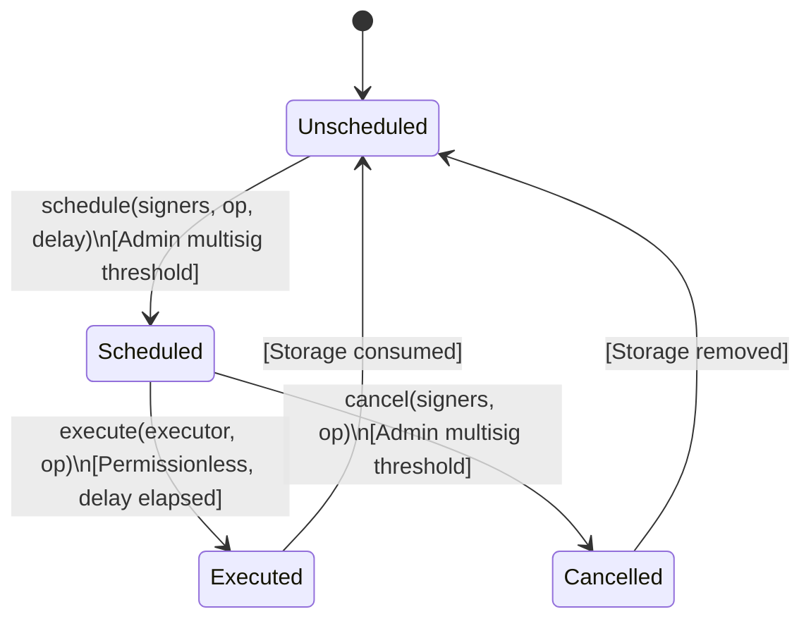

# Scheduled Operation Lifecycle

This document defines the lifecycle states, authorization rules, collision-handling mechanics, and operational guarantees for administrative timelocked operations within the BettaPay settlement contract (`settlement_contract`).

---

## 1. Lifecycle States and State Transitions

Administrative changes in the settlement contract pass through a four-state lifecycle:



### State Definitions

1. **`Unscheduled`**:
   - The operation is not present in contract persistent storage (`DataKey::ScheduledOperation(op_hash)` does not exist).
   - Calling `execute()` or `cancel()` in this state fails with `SettlementError::OperationNotScheduled` (Error code `11`).

2. **`Scheduled`**:
   - The operation has been validated and queued via `schedule(env, signers, operation, execute_in)`.
   - The entry exists in persistent storage under `DataKey::ScheduledOperation(op_hash)` as a `ScheduledOp { operation_xdr, execute_at }`.
   - Attempting to re-schedule while in this state triggers duplicate or collision checks.

3. **`Executed`**:
   - The timelock duration has elapsed (`env.ledger().timestamp() >= execute_at`).
   - `execute(env, executor, operation)` consumes the storage key atomically, runs the operation's specific action, and emits an `op_executed` event.
   - The operation transitions back to `Unscheduled` (its storage entry is deleted).

4. **`Cancelled`**:
   - Prior to execution, admins cancel the pending operation via `cancel(env, signers, operation)`.
   - The storage entry is removed atomically and an `op_cancelled` event is emitted.
   - The operation transitions back to `Unscheduled`.

---

## 2. Storage Keying and Hash Collision vs Duplicate Reschedule

### Storage Representation

- **Key**: `DataKey::ScheduledOperation(BytesN<32>)` where the 32-byte hash is computed as:
  $$\text{op\_hash} = \text{sha256}(\text{operation.to\_xdr}(\text{env}))$$
  The SHA-256 digest serves solely as a fixed-size index into Soroban persistent storage.
- **Value**: `ScheduledOp` struct containing:
  - `operation_xdr: Bytes` — The exact full XDR binary encoding of the scheduled operation.
  - `execute_at: u64` — The UNIX timestamp in seconds at and after which execution is permitted.

### Duplicate Reschedule vs Genuine Hash Collision

Because the SHA-256 digest is only an index, a key match does not prove that the operation in hand is identical to what was stored. The contract inspects `stored.operation_xdr == incoming_operation_xdr`:

| Scenario | Storage Condition | Raised Error | Error Code | Description / Security Implication |
|---|---|---|---|---|
| **Duplicate Reschedule** | Key exists AND `stored.operation_xdr == operation_xdr` | `OperationAlreadyScheduled` | `12` | The exact same operation is already pending in the timelock queue. Re-scheduling is rejected to avoid resetting or altering the existing timelock delay. |
| **Genuine Hash Collision** | Key exists AND `stored.operation_xdr != operation_xdr` | `OperationHashCollision` | `316` | A distinct operation payload produced the exact same 32-byte SHA-256 hash. The new schedule is rejected to prevent overwriting or blocking the existing pending operation. |
| **Execution Collision Guard** | Key exists AND `stored.operation_xdr != operation_xdr` | `OperationNotScheduled` | `11` | An un-scheduled operation that happens to collide on SHA-256 cannot execute or ride an unrelated pending operation's timelock slot. |
| **Cancellation Collision Guard** | Key exists AND `stored.operation_xdr != operation_xdr` | `OperationNotScheduled` | `11` | A colliding operation cannot cancel an unrelated pending operation's timelock entry. |

Neither a failed duplicate schedule nor a colliding schedule alters or deletes the existing pending operation in storage.

---

## 3. Timing and TTL Policies

### Minimum Timelock Delay

- Timelock delays are governed by:
  - `DEFAULT_TIMELOCK_DELAY_SECONDS = 7 * 24 * 60 * 60` (7 days / 604,800 seconds).
  - `MIN_TIMELOCK_DELAY_SECONDS = DEFAULT_TIMELOCK_DELAY_SECONDS` (7 days).
- In `schedule()`, the requested `execute_in` parameter must satisfy:
  $$\text{execute\_in} \ge \text{MIN\_TIMELOCK\_DELAY\_SECONDS}$$
  If `execute_in < MIN_TIMELOCK_DELAY_SECONDS`, the call immediately panics with `SettlementError::ExecutionNotReady` (Error code `10`).
- In `execute()`, the current ledger timestamp must satisfy:
  $$\text{env.ledger().timestamp()} \ge \text{scheduled.execute\_at}$$
  If the timelock period has not passed, `execute()` panics with `SettlementError::ExecutionNotReady` (Error code `10`).

### Persistent Storage TTL Policy

Scheduled operations reside in persistent storage under `DataKey::ScheduledOperation`. To ensure pending operations do not expire before their timelock matures:
- **`SCHEDULED_OP_TTL_THRESHOLD`**: `14` days in ledgers ($17,280 \times 14 = 241,920$ ledgers).
- **`SCHEDULED_OP_TTL_BUMP`**: `30` days in ledgers ($17,280 \times 30 = 518,400$ ledgers).
- Whenever `schedule()` writes a `ScheduledOp`, it immediately invokes `extend_ttl(SCHEDULED_OP_TTL_THRESHOLD, SCHEDULED_OP_TTL_BUMP)`.
- Upon `execute()` or `cancel()`, the key is removed from storage.

---

## 4. Emergency Recovery Veto

A pending emergency admin recovery acts as an immediate veto authority over the timelock queue:

- If `CommonDataKey::PendingRecovery` is present in instance storage:
  - **Every** scheduled operation in `execute()` is blocked with `SettlementError::RecoveryDelayActive` (Error code `9`).
  - **Exception**: `Operation::CancelRecovery` is permitted to execute even while recovery is pending.
- The veto check runs **before** the scheduled storage key is consumed. As a result, pending operations remain safely queued and intact until the recovery situation is resolved (either executed or cancelled).
- This ensures that a compromised admin set cannot execute scheduled upgrades or admin transfers while the recovery address is executing an emergency intervention.

---

## 5. Permissionless Execution Policy

The execution phase is deliberately permissionless:

- **Schedule Auth**: Requires admin multisig signatures meeting the configured `Threshold` (`verify_admin_auth`).
- **Cancel Auth**: Requires admin multisig signatures meeting the configured `Threshold` (`verify_admin_auth`).
- **Execute Auth**: **Permissionless** (`execute(env, executor, operation)`).
  - No authentication is demanded from `executor`.
  - Any user, backend relayer, or automated keeper service can trigger execution once `execute_at` has elapsed.
  - Uniform policy: applies across all nine operation variants (including `CancelRecovery`).

---

## 6. The Nine Operation Variants

The `Operation` enum in `settlement_contract::types` contains exactly nine variants:

| # | Variant | Payload | Execution Effect |
|---|---|---|---|
| 1 | `UpdateGovernance(Address)` | `new_gov: Address` | Validates that `new_gov` implements `get_fee_config`, updates `DataKey::Governance`, and emits `governance_updated`. |
| 2 | `CancelRecovery` | None | Removes `CommonDataKey::PendingRecovery` from instance storage and emits `recovery_cancelled`. Executable even while a recovery is pending. |
| 3 | `TransferAdmin(Vec<Address>, u32)` | `new_admins: Vec<Address>`, `new_threshold: u32` | Replaces the admin set and multisig threshold (`write_admins`). Validates non-zero addresses, non-registered merchant status, and threshold bounds ($1 \le \text{threshold} \le \text{admins.len()}$). Emits `admin_transferred` and `threshold_changed`. |
| 4 | `Upgrade(BytesN<32>)` | `wasm_hash: BytesN<32>` | Probes interface compatibility via `probe_supports_interface`, executes `env.deployer().update_current_contract_wasm(wasm_hash)`, and emits `contract_upgraded`. |
| 5 | `RegisterMerchant(Address)` | `merchant: Address` | Registers the merchant by writing `DataKey::Merchant(merchant) = true`, deletes any existing `ArchivedMerchant` tombstone, and emits `merchant_registered`. |
| 6 | `UnregisterMerchant(Address)` | `merchant: Address` | Removes `DataKey::Merchant(merchant)`, writes `DataKey::ArchivedMerchant(merchant)` tombstone, deletes merchant-specific `DataKey::Rule(merchant)`, and emits `merchant_unregistered` and `settlement_rule_cleared`. |
| 7 | `SetSettlementRule(Address, SettlementRule)` | `merchant: Address`, `rule: SettlementRule` | Validates fee bps and delay bounds against governance ceilings, writes `DataKey::Rule(merchant)`, extends TTL, and emits `settlement_rule_updated`. |
| 8 | `ClearSettlementRule(Address)` | `merchant: Address` | Deletes `DataKey::Rule(merchant)`, resolves the effective fallback rule (without emitting `bootstrap_fallback`), and emits `settlement_rule_cleared`. |
| 9 | `SetDefaultRule(SettlementRule)` | `rule: SettlementRule` | Validates fee bps and delay bounds against governance ceilings, writes singleton `DataKey::DefaultRule` to instance storage, and emits `default_rule_updated`. |

---

## 7. Queue-Depth Metric

Soroban cannot enumerate persistent `ScheduledOperation` keys, so the contract maintains an explicit queue-depth counter for operators, indexers, and monitoring dashboards.

- **Key**: `DataKey::PendingOperationCount` in **instance** storage.
- **Value**: `u32` number of entries currently pending in the timelock queue.
- **Absence**: a missing key means an empty queue, so a fresh contract reports `0` without an initialisation write.
- **Query**: `get_pending_operation_count()` is read-only, permissionless, and TTL-neutral.

### Maintenance Rules

| Transition | Effect on counter |
|---|---|
| `schedule()` writes a new `ScheduledOperation` slot | Incremented by 1 |
| `execute()` consumes the slot (`consume_scheduled_operation`) | Decremented by 1 |
| `cancel()` removes the slot | Decremented by 1 |
| `cancel_all()` removes each matching slot | Decremented once per actually-removed entry |

Decrements saturate at zero, so a repeated or skipped removal cannot underflow the counter. Failed calls that panic (for example a duplicate schedule, a missing-operation cancel, or an early `ExecutionNotReady`) roll back their storage writes and therefore leave the counter unchanged.

Because the counter lives in instance storage, it shares the contract instance TTL and needs no separate TTL bump. Build tooling that needs a pending-operation list (for example `scripts/list_pending_ops.sh`) still reconstructs entries from `op_scheduled` / `op_executed` / `op_cancelled` events; the counter is the authoritative count to reconcile against.

### Example

```rust
let pending = client.get_pending_operation_count();
if pending > 0 {
    // Reconcile against op_scheduled minus op_executed/op_cancelled events.
}
```
